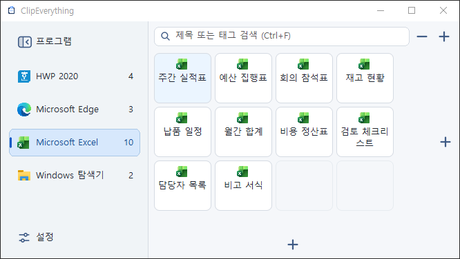
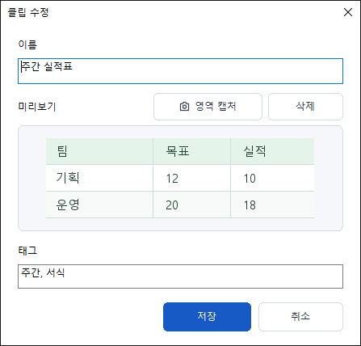

# ClipEverything

[English](README.md) · 한국어

**매일매일 반복되는 지긋지긋한 업무.** 어제 보낸 회의 안내, 매주 만드는 실적표, “검토 결과를 공유드립니다.” 오늘도 그 문장을 찾으려고 지난 문서를 열었다면, 이제 버튼 하나에 넣어 두세요.

ClipEverything은 자주 쓰는 문구와 서식, 표, 이미지, 파일 선택을 프로그램별 버튼판에 보관하는 Windows x64 앱입니다. 한 번 저장해 두고 다음부터는 단축키로 꺼내 쓰면 됩니다.



## 일단 받아서 열어 봅시다

**처음이라면 MSI가 가장 간단합니다.** 아래에서 MSI를 받아 실행하고, 기본 설정 그대로 설치한 뒤 **마침**을 누르면 버튼판이 열립니다.

| 다운로드 | 이렇게 쓰세요 |
| --- | --- |
| [ClipEverything.msi](https://github.com/HosooJeong/ClipEverything/releases/latest/download/ClipEverything.msi) | Windows x64 설치용입니다. 시작 메뉴·바탕화면 바로가기, 로그인 시 실행, 기본 단축키를 고를 수 있습니다. |
| [ClipEverything.exe](https://github.com/HosooJeong/ClipEverything/releases/latest/download/ClipEverything.exe) | 파일을 바로 실행합니다. 보관함은 Windows 사용자 프로필에 저장합니다. |
| [ClipEverything-portable.zip](https://github.com/HosooJeong/ClipEverything/releases/latest/download/ClipEverything-portable.zip) | 쓰기 가능한 폴더에 압축을 전부 풀고 `ClipEverything.exe`를 실행합니다. `portable.flag`를 EXE 옆에 두면 그 폴더에 보관함이 생깁니다. |

## 첫 문구를 저장하고 붙여넣기

1. **문구를 잡아 둡니다.** ClipEverything을 켠 상태에서 메모장에 ‘검토 결과를 공유드립니다.’를 써 보세요. 문장 전체를 선택하고 **Ctrl+Alt+C**를 누릅니다.
2. **찾기 쉬운 이름을 붙입니다.** 등록창의 **이름**에 ‘검토 회신’이라고 적고 **저장**을 누릅니다. 태그를 붙이거나 **영역 캡처**로 미리보기를 만들 수도 있습니다. 미리보기는 항목을 구분할 때 쓰고, 붙여넣을 때는 저장한 원본이 들어갑니다.
3. **다시 꺼내 씁니다.** 메모장 새 줄에 커서를 두고 **Ctrl+Alt+V**를 누릅니다. 버튼판에서 ‘검토 회신’을 클릭하거나 방향키로 선택한 뒤 **Enter**를 누르면, 커서를 두었던 자리에 붙여넣습니다. 다른 프로그램에서 저장한 클립은 왼쪽에서 해당 프로그램을 선택하면 됩니다.



## 버튼이 늘어나면

- **찾을 때는 검색.** 왼쪽에서 프로그램을 고르고 **Ctrl+F**를 눌러 이름이나 태그로 검색합니다. 버튼에 마우스를 올리면 미리보기가 나옵니다.
- **자주 쓰는 건 손에 익는 자리로.** 버튼을 끌어다 놓아 배치합니다. 창 가장자리를 드래그하면 버튼 한 칸 단위로 크기가 맞춰집니다. 창을 줄여 가려진 클립은 페이지를 넘기거나, 우클릭 → **자동 정렬**로 현재 열 수에 맞춰 다시 모을 수 있습니다.
- **내가 원하는 순간에 붙여넣기.** Windows 트레이의 ClipEverything 메뉴에서 버튼판을 열고 버튼을 누릅니다. 체크가 뜨면 복사된 것이니, 원하는 창에서 **Ctrl+V**를 누르세요.
- **단축키가 겹친다면.** 사이드바 아래 **설정**에서 등록과 버튼판 열기 단축키를 바꿀 수 있습니다.
- **버튼에 뭘 보여 줄까요?** 설정의 **버튼에 표시할 내용**에서 프로그램 아이콘, 미리보기, 표시 안 함을 고를 수 있습니다. 클립 이름은 항상 보입니다. 단축키가 헷갈리면 설정 아래 책 아이콘을 눌러 사용 방법을 확인하세요.

보관함은 PC에 저장됩니다. 기본 경로는 `%APPDATA%\ClipEverythingRust`이며, 포터블은 실행 파일 옆의 `portable-data-rust`를 사용합니다. 표나 이미지의 붙여넣기 결과는 대상 프로그램이 지원하는 형식에 따라 달라집니다.

## 빌드

Windows x64에서 Rust MSVC 툴체인, Visual Studio C++ Build Tools, Windows SDK를 준비합니다.

```powershell
cd rust
cargo test --workspace --locked --release
.\package.ps1
```

MSI를 만들려면 .NET SDK를 설치한 뒤 같은 폴더에서 다음 명령을 실행합니다.

```powershell
dotnet tool install --tool-path target/pack-tools wix --version 4.0.6
.\package.ps1 -Installer
```

배포 파일은 `rust/dist/`에 생성됩니다. 설치 옵션, 이전 보관함 가져오기, 소스 구성은 [프로젝트 안내](rust/README.md)에서 확인할 수 있습니다.
