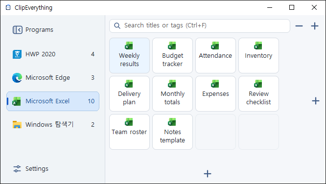
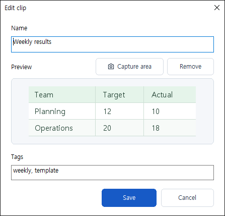

# ClipEverything

English · [한국어](README.ko.md)

**Save once. Paste whenever you need it.** ClipEverything is a Windows x64 app for the phrases, tables, formatting, images, and file selections you use again and again. Give each clip a name, keep it on its source application's board, and call it up with a shortcut.



## Download

**New to ClipEverything? Start with the MSI.** Open the downloaded file, keep the default options for a quick start, and click the finish button to open the board.

| File | How to start |
| --- | --- |
| [ClipEverything.msi](https://github.com/HosooJeong/ClipEverything/releases/latest/download/ClipEverything.msi) | Windows x64 installer. You can choose shortcuts, sign-in startup, and tray behavior. |
| [ClipEverything.exe](https://github.com/HosooJeong/ClipEverything/releases/latest/download/ClipEverything.exe) | Run the EXE directly. It uses your Windows user profile for storage. |
| [ClipEverything-portable.zip](https://github.com/HosooJeong/ClipEverything/releases/latest/download/ClipEverything-portable.zip) | Extract the entire ZIP to a writable folder and run `ClipEverything.exe`. Keep `portable.flag` beside the EXE to store records there. |

## Save and paste your first clip

1. **Save a phrase.** With ClipEverything running, type a short phrase in Notepad, select it, and press **Ctrl+Alt+C**.
2. **Give it a name.** In the registration window, enter a name such as “Review reply” and click **Save**. You can also add tags or choose **Capture area** to save a visual preview. The preview helps identify the clip, and pasting uses the original saved content.
3. **Paste it.** Put the caret on a new line in Notepad and press **Ctrl+Alt+V**. Click **Review reply**, or select it with the arrow keys and press **Enter**. ClipEverything pastes into the original input field. If you saved the clip in another program, choose that program in the sidebar.



## Once your board fills up

- **Find a clip.** Choose the source program and press **Ctrl+F** to search its titles or tags. Hover over a tile to see its preview.
- **Keep frequently used clips within reach.** Drag tiles into an order you remember. Drag a window edge to resize in whole rows and columns. Clips that move offscreen are available on later pages. Right-click and choose **Auto arrange** to pack the current program’s clips into the visible column count.
- **Copy for manual pasting.** Open the board from the ClipEverything tray menu, click a tile and wait for the check mark, then press **Ctrl+V** in your destination.
- **Change the shortcuts.** Open **Settings** at the bottom of the sidebar. The steps above use the defaults.
- **Choose what tiles show.** In Settings, choose a program icon, a preview, or no visual. Clip names are always visible. The book icon below Settings opens the user guide with your current shortcuts.

Clips are stored locally. The default profile is `%APPDATA%\ClipEverythingRust`, and portable copies use `portable-data-rust` beside the executable. Rich formatting depends on what the receiving program supports.

## Build

Use Windows x64 with the Rust MSVC toolchain, Visual Studio C++ Build Tools, and the Windows SDK.

```powershell
cd rust
cargo test --workspace --locked --release
.\package.ps1
```

To build the MSI, install the .NET SDK and run these commands from the same directory.

```powershell
dotnet tool install --tool-path target/pack-tools wix --version 4.0.6
.\package.ps1 -Installer
```

Build outputs go to `rust/dist/`. For installation options, legacy data import, and source layout, see the [project guide](rust/README.md).
